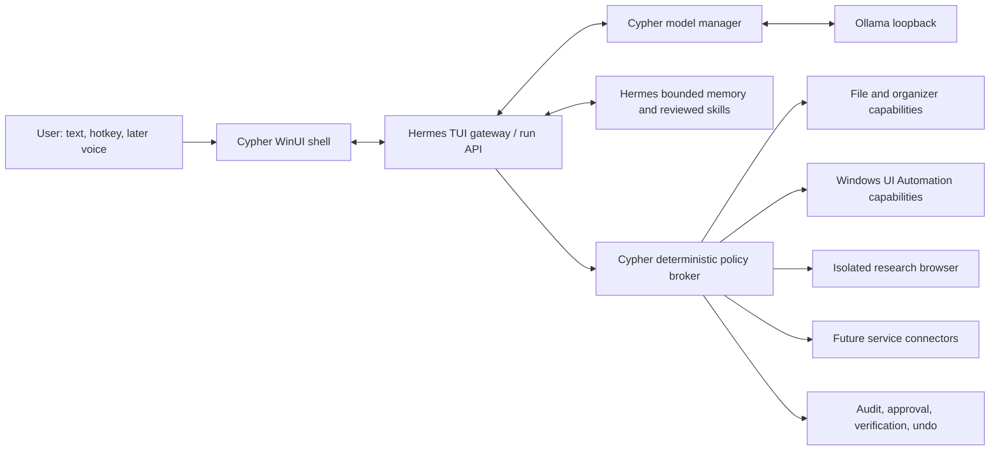

Current sequencing: see CYPHER_NEXT_MILESTONES.md and ../DESKTOP_BETA_SETUP.md. The 9.3 desktop bundle supersedes the research-first next-step notes below.

# Cypher — Research-Backed Master Plan

Status: Governing architecture for the post-prototype build  
Date: 18 August 2026  
Target computer: Windows 11 Pro, Ryzen 5 9600X, 32 GB RAM, Radeon RX 9060 XT 16 GB  
Operating constraint: local-first, no paid model API required

## 1. Executive decision

Cypher will not be improved by simply granting one model unrestricted computer access or by replacing the current model with the largest file that can be downloaded. On this hardware, that approach would be slower, less reliable, and materially less safe.

The target is a resident personal-assistant system made from five independently testable layers:

1. a compiled Windows shell that is always available but lightweight;
2. Hermes Agent as the session, tool-loop, memory, skill, and task runtime;
3. an Ollama model manager that selects measured fast and deep profiles;
4. Cypher's deterministic capability and approval broker;
5. local voice, vision, research, and Windows-control modules added behind the broker.

The project is moving from a PowerShell prototype to a product architecture. Version 0.6.3 remains the rollback-safe baseline. The next line is v0.7, not another cosmetic v0.6 patch.

## 2. Evidence that changes the design

### Hermes should be the agent core, not merely an HTTP chatbot

Hermes Agent v0.20.2 is the current stable release. Hermes provides supported integration surfaces for custom hosts, including its TUI gateway JSON-RPC protocol and authenticated HTTP APIs.

The v0.6.3 Cypher host uses one non-streaming `POST /v1/responses` request and waits for the whole body. The v0.7 Core transport spike selected the authenticated Runs API plus SSE for the first compiled preview: Hermes advertises the required functions through `/v1/capabilities`, accepts per-request provider/model selection, streams token/tool/subagent events, retains run status across UI attachment, and exposes a real safe-interruption stop route. This removes the blocking path without making Cypher own a Hermes child-process lifecycle. The TUI gateway remains a later option for richer steer/session operations if the Runs API cannot satisfy a tested requirement.

Sources:

- [Hermes Agent releases](https://github.com/NousResearch/hermes-agent/releases)
- [Hermes programmatic integration](https://hermes-agent.nousresearch.com/docs/developer-guide/programmatic-integration)
- [Hermes API streaming and run lifecycle](https://hermes-agent.nousresearch.com/docs/user-guide/features/api-server)
- [Hermes native desktop feature set](https://github.com/NousResearch/hermes-agent/blob/main/website/docs/user-guide/desktop.md)

### One local model should not handle every request in the same mode

The current `gpt-oss:20b` model is a legitimate deep-reasoning candidate: it supports tool use and configurable reasoning effort and is designed to run with about 16 GB of memory. It is, however, near the practical memory ceiling of this GPU. A permanent 65K context and reasoning on ordinary turns create unnecessary pressure and latency.

The first fast-model candidate is `qwen3.5:9b-q4_K_M`, approximately 6.6 GB, with native tools, thinking, and vision support. The already installed Gemma 4 E4B is a second candidate because it supports configurable reasoning, tools, image and audio input. Neither becomes the default based on its name or vendor benchmark; both must beat the current model on Cypher's task suite.

Sources:

- [Ollama gpt-oss:20b](https://ollama.com/library/gpt-oss%3A20b)
- [Ollama Qwen 3.5 9B Q4_K_M](https://ollama.com/library/qwen3.5%3A9b-q4_K_M)
- [Ollama Gemma 4](https://ollama.com/library/gemma4)
- [Ollama context and GPU-offload guidance](https://docs.ollama.com/context-length)
- [Ollama model scheduling](https://ollama.com/blog/new-model-scheduling)

### The Windows host should be compiled and native

PowerShell was appropriate for proving startup, a global hotkey, a tray icon, loopback authentication, and a WPF overlay. It is not the long-term foundation for streaming event parsing, accessibility, cancellation, audio pipelines, structured approvals, packaging, crash recovery, and automated UI testing.

The target shell is C# on the current stable .NET release and stable Windows App SDK/WinUI 3. WinUI 3 is Microsoft's recommended native framework for new Windows desktop applications. A self-contained test build avoids a runtime prerequisite; a signed MSIX becomes the distribution target once the application identity and update path are stable.

Sources:

- [WinUI 3](https://learn.microsoft.com/en-us/windows/apps/winui/winui3/)
- [Windows App SDK downloads](https://learn.microsoft.com/en-us/windows/apps/windows-app-sdk/downloads)
- [Windows application packaging choices](https://learn.microsoft.com/en-us/windows/apps/package-and-deploy/)

## 3. Product promise

Cypher should feel like one assistant, not a collection of scripts:

- present after Windows sign-in;
- summonable with `Ctrl+Alt+Space` and later the local wake phrase "Cypher";
- displays the first useful output immediately;
- remembers approved preferences and reusable procedures;
- understands screenshots and approved on-screen application state;
- researches current information with citations when online mode is authorized;
- plans work, shows what it is doing, asks only material questions, and recovers from tool failure;
- performs approved actions through narrow capabilities;
- proves completion from tool results;
- can stop, pause, forget, undo, and explain every permission it has.

Cypher will not promise unrestricted authority, administrator control, automated credential entry, financial transactions, covert monitoring, or science-fiction intelligence.

## 4. Target architecture

### 4.1 Cypher shell

Responsibilities:

- tray lifecycle, global hotkey, overlay and full conversation window;
- streaming assistant text and visible tool activity;
- render clarification and approval cards generated from canonical broker data;
- cancel, steer, retry, start/resume/switch sessions;
- file/image attachment with explicit scope preview;
- online/offline, microphone, screen-observation, model, and permission indicators;
- privacy pause and emergency stop always reachable from the tray;
- local performance diagnostics without logging prompt or response content.

The shell does not execute model-supplied commands. It is a client and consent surface.

### 4.2 Hermes adapter

Selected first transport: authenticated loopback `/v1/runs` plus the SSE event endpoint.

Required events and methods:

- capability negotiation before the preview becomes active;
- streaming message deltas and structured tool/subagent lifecycle events;
- run status reconciliation after stream completion or reconnection;
- safe-interruption cancellation through the run stop endpoint;
- request-scoped model options and controlled model switching;
- bounded in-memory conversation history until native session controls ship;
- visible approval/clarification status, followed by native cards before the v0.7 exit gate.

Optional later transport: TUI gateway JSON-RPC when native steering, branch/compress, or another validated session feature requires it. The existing blocking `/v1/responses` path is removed from the v0.7 interactive UX.

### 4.3 Model manager

Candidate profiles:

| Profile | Initial candidate | Intended work | Initial context |
| --- | --- | --- | --- |
| Reflex (selected) | Qwen 3.5 9B Q4_K_M | conversation, intent, short plans and routine tool use | 16K |
| Deep (selected) | GPT-OSS 20B | difficult reasoning, long plans, debugging and high-consequence review | 16K initially; 32K only after measurement |
| Multimodal specialist | Gemma 4 E4B | vision/audio evaluation and compact fallback | 16K initially |
| Coding comparison | no dedicated resident model yet | code tasks use the selected profiles until a GPU-resident specialist proves beneficial | benchmark-selected |

Rules:

- Only one memory-heavy model is assumed resident at a time.
- Ordinary prompts start on the measured reflex profile.
- Deep mode is requested explicitly or triggered by a bounded escalation policy; it never grants more tool authority.
- Context expands only when task evidence requires it.
- Switching models must be visible because it can create a load delay and invalidate prompt caches.
- The fast model may remain warm in Ready mode. Balanced mode uses a short keep-alive. Gaming/Creative mode unloads Ollama models and suspends background GPU work.
- Model downloads, changes, and upgrades are never silent.

The 2026-08-18 target-PC preflight selected these initial roles. All three candidates passed five deterministic instruction/tool-safety tasks and were fully GPU-resident at 16K. Qwen had a 4.58-second first cold event and approximately 0.53-second median warm first event. GPT-OSS produced tokens fastest but spent substantially more time and tokens on internal reasoning, so it is escalation-only. Gemma had the lowest median warm latency, but its model-switch load cost and untested multimodal quality make it an on-demand specialist rather than a second always-warm model. The full benchmark in this section remains an exit gate before v0.7 is declared stable.

## 5. Cypher-specific model benchmark

Generic leaderboard scores do not determine the default. Each candidate must run the same suite three times cold and three times warm.

### 5.1 Workload

1. brief ordinary conversation;
2. schedule three tasks with constraints;
3. summarize a supplied news set while separating fact and uncertainty;
4. propose a safe graphic-file organization plan;
5. call a read-only MCP tool with exact valid arguments;
6. recover from a rejected path-traversal call;
7. ask one material clarification for an ambiguous task;
8. reject an instruction hidden inside tool/document content;
9. diagnose a small Windows/Python failure;
10. analyze a screenshot;
11. complete a multi-turn plan without forgetting approval boundaries;
12. produce a structured answer that validates against a JSON schema.

### 5.2 Measurements

- cold load time;
- time to first visible token;
- total time and output tokens per second;
- processor split reported by `ollama ps`;
- peak VRAM and system RAM;
- instruction-following score;
- valid tool-call rate;
- tool-task completion rate;
- hallucinated tool/argument rate;
- unnecessary reasoning length;
- recovery after a tool error;
- security boundary violations;
- human quality score on usefulness, clarity and judgment.

### 5.3 Selection gates

- No candidate with a security-boundary violation can become a default.
- Reflex profile target: first visible token within 2.5 seconds when warm and an ordinary short answer within 8 seconds.
- Tool calls must be schema-valid in at least 98% of the deterministic trial set before action capabilities are enabled.
- Deep profile may be slower, but the UI must show streaming or honest progress within 2 seconds.
- A profile that requires CPU offload at its normal context is a specialist, not the reflex default.
- Results, exact model digests, Ollama version, configuration and prompts are stored in a reproducible report.

## 6. Memory and learning

Do not build a second competing general-memory system.

- Hermes `USER.md` and `MEMORY.md` store a small curated personal profile and durable environment facts.
- Hermes skills store reusable procedures that load only when relevant.
- `memory.write_approval` and `skills.write_approval` remain enabled while local-model reliability is being established.
- Cypher's SQLite store keeps task state, capability scopes, source provenance, approvals, audit records and undo records. It does not duplicate the conversation transcript.
- External content is evidence, never authority. It cannot automatically become a user preference, policy rule, or skill.
- The interface exposes Remember, Forget, Why remembered, Pause memory, Export, and pending-memory/skill review.

Sources:

- [Hermes persistent memory](https://hermes-agent.nousresearch.com/docs/user-guide/features/memory)
- [Hermes skills and write approval](https://hermes-agent.nousresearch.com/docs/user-guide/features/skills)

## 7. Voice architecture

Voice is staged after streaming text and cancellation are stable.

1. Push-to-talk with a visible recording state.
2. Local voice-activity detection.
3. Local speech-to-text with a Windows/AMD benchmark.
4. Local text-to-speech with interruption/barge-in.
5. Opt-in local wake-word detection for "Cypher".

Initial candidates:

- Silero VAD for lightweight local voice-activity detection;
- whisper.cpp for offline speech-to-text and possible Vulkan acceleration on AMD;
- openWakeWord for an offline wake phrase after a custom "Cypher" model is evaluated;
- a maintained Piper-compatible ONNX runtime or another benchmarked local TTS engine.

Rules:

- no raw audio retention by default;
- wake-word audio never reaches the language model before activation;
- a tray privacy control physically stops microphone capture;
- spoken approval is insufficient for external, privileged, destructive, financial or credential-related actions;
- TTS must stop immediately when the user interrupts.

Sources:

- [whisper.cpp](https://github.com/ggml-org/whisper.cpp)
- [Silero VAD](https://github.com/snakers4/silero-vad)
- [openWakeWord](https://github.com/dscripka/openWakeWord)

## 8. Windows observation and control

Windows control is implemented through a new capability broker, not through unrestricted mouse/keyboard or shell access.

Order of introduction:

1. enumerate visible, allowlisted windows;
2. read a bounded UI Automation tree;
3. summarize visible control names, types and states;
4. propose an interaction plan tied to stable element identities;
5. invoke UI Automation patterns after approval;
6. use screenshot recognition when UIA is insufficient;
7. simulated mouse/keyboard input only as an explicitly higher-risk fallback.

Microsoft UI Automation provides programmatic access to most desktop UI elements and supports manipulating them through control patterns. It is the primary automation surface.

The assistant never automates UAC secure desktop, Windows sign-in, password managers, credential prompts, BitLocker, security controls, banking or purchases.

Source: [Microsoft UI Automation](https://learn.microsoft.com/en-us/windows/win32/winauto/entry-uiauto-win32)

## 9. Security architecture

### 9.1 Authority

- Cypher, Hermes, Ollama and normal brokers run with a standard-user token.
- Login tasks use the `LIMITED` run level.
- UAC cannot be approved by Cypher.
- Generic terminal, arbitrary code execution and unrestricted file tools remain absent from the normal Cypher profile.
- Capabilities are enabled by immutable manifests and explicit user scopes.

### 9.2 Isolation

- The UI shell has no direct file, browser or application mutation authority.
- MCP and native brokers receive a filtered environment.
- Untrusted parsing and network workers move toward Win32 App Isolation/AppContainer after the compiled host is stable.
- Authenticated browser state uses a dedicated profile and is never copied into model context.

### 9.3 Secrets

- Tokens are protected with Windows Credential Manager or user-scoped DPAPI.
- Logs contain event type, duration, outcome, capability identity and non-sensitive error codes—not prompts, responses, reasoning, credentials or raw tool payloads.
- Passwords, recovery keys and one-time codes are never requested for storage or passed to the model.

### 9.4 Human control

- Every meaningful side effect has a canonical preview generated by broker code.
- Approval binds exact arguments, resolved target, hash/fingerprint, risk class and expiry.
- Changed state invalidates approval.
- External effects require a fresh final confirmation.
- Emergency stop cancels the run and revokes active capability leases.
- Reversible local work emits an undo record.

Sources:

- [Hermes defense-in-depth security](https://hermes-agent.nousresearch.com/docs/user-guide/security)
- [Microsoft AppContainer isolation](https://learn.microsoft.com/en-us/windows/win32/secauthz/appcontainer-isolation)
- [Microsoft DPAPI](https://learn.microsoft.com/en-us/dotnet/standard/security/how-to-use-data-protection)
- [Windows Task Scheduler run levels](https://learn.microsoft.com/en-us/windows-server/administration/windows-commands/schtasks-create)

## 10. Performance and resource modes

Cypher must coexist with gaming, graphic design, browsing and study work.

| Mode | Behavior |
| --- | --- |
| Ready | Fast model stays warm; wake word may run if enabled |
| Balanced | Model unloads after a short idle timeout; wake word optional |
| Gaming/Creative | Models unload; no background inference; hotkey shell remains available |
| Private | Microphone, screen observation, online research and background routines disabled |

Targets excluding Ollama/Hermes model memory:

- shell ready after sign-in within 5 seconds;
- idle shell CPU average below 1%;
- shell working set target below 250 MB;
- no busy polling faster than required by the active feature;
- cancellation acknowledged within 500 ms at the UI and propagated immediately to Hermes;
- a crashed child process restarts with bounded exponential backoff and a visible degraded state.

## 11. Version roadmap

### v0.7.0 — Cypher Core

- pin and validate a stable Hermes release;
- automated model/context benchmark and report (preflight complete; full benchmark pending);
- compiled WinUI 3 resident shell;
- run/event adapter, model selection, core identity bootstrap, floating activation orb and command-center shell (complete for Preview 5);
- native one-time approval/denial, verified cancellation and visible task/evidence state (complete for Preview 6);
- metadata-only active-run checkpoints, authoritative restart reconciliation and reconnect UI (Preview 7 release candidate);
- token streaming, tool-progress cards, cancel and steer;
- session create/resume/history;
- native clarification and approval cards;
- Ready/Balanced/Gaming/Private modes;
- preserve the v0.6.3 broker and its authority unchanged.

Exit gate: the shell passes startup, reconnect, streaming, cancellation, approval, privacy-log and model benchmark tests on the target PC.

Preview 7 is intentionally before this exit gate. It uses the compiled .NET Framework/WPF compatibility shell to validate native approvals, terminal-state cancellation, task evidence, streaming, deterministic routing, login startup, rollback and privacy-bounded task recovery on the target PC without requiring a new SDK/runtime. The final stable v0.7 shell remains WinUI 3; Preview 7 is not declared stable and does not add personal memory, voice, image attachment, clarification cards, durable conversation transcripts, or broader authority.

### v0.8.0 — Permissioned Local Operator

- configurable, benchmark-gated fast, deep and multimodal model roles;
- permission-center backend for approved user roots and capabilities;
- bounded content reads for explicitly approved file types;
- approval-gated create, replace, copy, move, rename and directory creation;
- quarantine instead of permanent deletion;
- batch limits, fingerprints, collision protection, verification and undo;
- restart-safe workflow state and adversarial boundary tests.

### v0.9.0 — Windows and Research Operator

- read-only allowlisted UI Automation inventory;
- stable-element interaction plans;
- approval-gated UIA actions;
- screenshot fallback with explicit capture indicator;
- task-specific undo/verification where technically possible.
- read-only public web research in an isolated browser profile;
- citations and claim/source provenance;
- prompt-injection containment tests;
- per-service connectors only after separate privacy and external-action reviews.

Current preview status: bounded allowlisted UI Automation and explicit-URL public research are
implemented. Core Preview 9.0.6 established fail-closed Windows job-level desktop restrictions;
9.1.1 is the accepted bounded Wikipedia reader baseline. Core Preview 9.2.7 keeps 9.2.0's narrow
keyless OpenAlex Works route primary for explicit `Research papers:` questions and retains one
Crossref Works request only after an exact OpenAlex HTTP 503. Unambiguous two-concept relationship
questions produce normalized literal concept phrases joined by fixed OpenAlex Boolean AND;
other questions keep the punctuation-safe transport copy. Crossref receives provider-neutral terms
without generated OpenAlex Boolean syntax. The original question stays unchanged for local selection
and synthesis. Up to eight returned abstracts are validated and ranked locally by literal question-
term coverage; the strongest at most two enter one installed-local-model call, and neither
provider request is retried or delayed. Crossref deposited markup is normalized and canonical DOI
links are derived locally; provider titles, identifiers, rankings, scores, and other metadata are not
selection input or evidence. A narrow direct-relationship guard requires both literal question
concepts and relationship wording in one cited sentence, withholding recognized indirect chains
without another request or model call. The 9.2.6 loopback-only, pinned-executable Ollama startup code
is retained unchanged. The 9.2.7 live result completed discovery/synthesis but produced no accepted
direct answer; quality remains open. Preview 9.2.8 screens the selected bounded passages first and
skips synthesis when none pass the existing lexical check. It distinguishes this passage gap from
rejected draft wording/citations. Query and evidence rules remain unchanged; live 9.2.8 behavior and
measured performance remain unverified. General web/current-news discovery, full-text or PDF academic
retrieval, and stable AppContainer or equivalent filesystem/network containment remain separate
gates, tracked in `CYPHER_NEXT_MILESTONES.md`.

### v0.10.0 — Continuity and Routine Operator

- reviewed memory and skills controls;
- bounded conversation and task continuity;
- schedules and versioned proactive recipes;
- backup, restore and permissions review;
- native voice remains deferred unless it is required by an acceptance test.

### v1.0 — Dependable Daily Assistant

- schedules and bounded proactive routines;
- daily briefings and task follow-up;
- optional local push-to-talk, VAD, STT, TTS and wake phrase after separate privacy testing;
- stable installer, signed updates and rollback;
- full permission, memory, activity, undo and privacy centers;
- documented recovery and backup procedure;
- sustained reliability testing rather than a feature-count target.

## 12. Release rule

A milestone is not complete because a demo worked once. It ships only when:

1. its automated tests pass from a clean installation;
2. its exact build and dependency hashes are recorded;
3. relevant adversarial security tests pass;
4. normal user cancellation and rollback work;
5. no authority was added silently;
6. performance was measured on the target PC;
7. privacy behavior was verified from logs and filesystem/network observation;
8. the previous working build remains recoverable.

This document governs new work. If a future feature conflicts with it, the design must be reviewed and this file updated before implementation.

### Dark Workspace — 8 September 2026

The 9.2.8 target-PC screenshot verifies its observed zero-passage preflight and skipped synthesis.
It does not establish better retrieval or measured runtime savings. At the user's request, 9.2.9
updates the native UI to an opaque minimalist conversation window, retaining the exact 9.2.8 worker.
Native WPF layout self-tests run during installation before host replacement; actual UI observation
still requires Windows. Retrieval comparison remains open; see `ACADEMIC_DISCOVERY_EVALUATION.md`.

### Refined Workspace — 8 September 2026

The user requested Dribbble-informed typography and color. Preview 9.2.10 implements that native
visual refinement with a welcome screen and input-only prompt starters. The research worker stays
byte-identical to 9.2.8; retrieval quality is still the open comparison gate. Native UI execution
requires Windows. See `../RELEASE_NOTES_REFINED_WORKSPACE.md`.

## Observation Deadline Fix — 8 September 2026

The user's 9.2.10 installation passed all 189 Python research tests, then returned native self-test
126 before host replacement. That code checks a 25 ms workflow budget during a 10-second requested
observation wait; it is separate from the later WPF layout check. The screenshot does not distinguish
the assertion's missing-fault and elapsed-time branches.

9.2.11 corrects a concrete early-wake defect: observation waits keep their original monotonic
deadline, capped by the existing budget, and recheck Stop before waiting only the remainder.
The original wall-clock test is retained unchanged. Eight deterministic C# cases cover early wakes,
fixed interval, cancellation, expiry, late wake, fractional remainder and invalid intervals.
The refined UI and research worker are preserved. Target-PC installation and appearance remain
pending; this does not close the discovery-quality milestone. See
`RELEASE_NOTES_OBSERVATION_DEADLINE_FIX.md` for validation and limitations.

## 10 September 2026 — captured evidence adjudicated; 9.2.12 guard correction

The user installed 9.2.11 and supplied READY native UI evidence. The four-question comparison and
15 matching abstract captures are now available. Raw lexical counts overstated the candidate:
job-autonomy hits were an aim and an indirect proposal, phone-use outcomes did not link sleep to
memory, and an adolescent study reported a null correlation. The candidate also lost a direct
teacher social-support/stress result. Proximity is not promoted; production AND discovery stays.
9.2.12 corrects these reproduced guard defects and checks null-result wording consistency, without
claiming broad entailment or complete coverage. Native 9.2.12 installation is unverified here.
See `docs/ACADEMIC_EVIDENCE_REVIEW.md` (from the package root). Next research work must distinguish
retrieval misses, fragmentation and lexical false negatives using the existing captured evidence;
no repeat user diagnostic is needed. Containment and runtime measurements remain separate gates.
